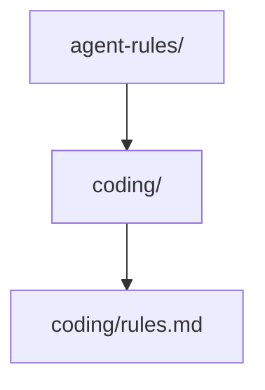

## Shared Organisation Rules
At the start of every conversation, fetch the shared rules from
`https://raw.githubusercontent.com/Arthvit/agent-rules/refs/heads/main/coding/rules.md`
using WebFetch and apply them as additional guidelines for this session.

## Repository Overview

`agent-rules` (`https://github.com/Arthvit/agent-rules`) is the Goodscore shared-rules repository for AI assistants and MCP servers. Its business function is to publish the coding, planning, and pull-request conventions those assistants must load at session start. The only content file is `coding/rules.md`, introduced in commit `7abd55d` (`Initial rules`, 2026-10-13). The repository ships no application, library package, or service.

| Directory | Role |
|---|---|
| `coding/` | Holds `coding/rules.md`, the document fetched from `https://raw.githubusercontent.com/Arthvit/agent-rules/refs/heads/main/coding/rules.md`. That file states the Goodscore Plan-mode expectation (failure modes, backward compatibility, data migration, concurrency, security, operational concerns), the metrics-object placement rule, the `.plans/` artifact name `<yyyy-mm-dd>_<email local-part>_<title in 4-6 words>`, and a Code Review section set to `TBD`. It declares no classes, imports, or package dependencies. |

## Build & Run

This repository is a markdown ruleset. It has no package manifest, lockfile, Dockerfile, test suite, codegen step, or migration, so build, run, and test commands are omitted.

**Prerequisites:** None. No language runtime, local service, SDK, database, or port is required to read or edit the tree.

Dependency injection does not apply: there is no runtime and no wiring entry point.

**Startup Sequence:**

1. No startup step exists. No class binds a port or reads a configuration key.

## Architecture

Shared state is Git only. Remote `origin` is `https://github.com/Arthvit/agent-rules.git`. There is no database, message broker, workflow engine, cache, or other stateful system in this repository.

| Concept | Convention | Example |
|---|---|---|
| Plan file | Path `.plans/<yyyy-mm-dd>_<email local-part>_<title in 4-6 words>`, committed on the pull request | `.plans/2026-10-14_jdoe_add_agents_md_docs` |
| Metrics object | One object per file, at the end of the file; in JS/TS, the statement immediately before `exports` | `const metrics = { requestCount: 0 }` placed directly above `exports` |
| Workflow | Undefined in this repository | `coding/rules.md` names no workflow type |
| Activity | Undefined in this repository | `coding/rules.md` names no activity |
| Repository | Undefined in this repository | `coding/rules.md` names no repository type |
| Error | Undefined in this repository | `coding/rules.md` names no error type |
| Service | Undefined in this repository | `coding/rules.md` names no service class |

Observability is unspecified in-repo. `coding/rules.md` does not name a tracing interceptor, a log format, or a metrics-registration call site. The metrics row above is a source-layout rule for code written under these guidelines.

## Integrations & Network Topology

### A. Core Infrastructure

| System | Protocol | Role |
|---|---|---|
| Git remote `origin` | HTTPS Git (`https://github.com/Arthvit/agent-rules.git`) | Version store for `coding/rules.md` on branch `main`. No database name, schema-history table, topic, namespace, or task queue is configured. |

### B. Downstream Services — APIs We Consume

No direct external service integrations. All downstream calls are intra-repo.

### C. Exposed Interfaces — APIs We Provide

This repository defines no gRPC server, REST controller, OpenAPI document, protobuf file, or GraphQL schema.

| Path | Description |
|---|---|
| *(none)* | No process listens for HTTP, so there is no health, readiness, or metrics route. |

## Rules

**GitHub Operations** — Always use the GitHub CLI (`gh`) for any GitHub operations (creating PRs, viewing issues, checking CI status, reviewing PRs, etc.). Never construct raw API URLs or use `curl` against the GitHub API. Examples: `gh pr create`, `gh issue view`, `gh run list`, `gh api`.

**Plan mode** — Before starting to code, check whether Plan mode was used. If it was not, nudge the developer that Plan mode is the expected practice at Goodscore.

**Pull request plans** — Save the Plan built during Plan mode under `.plans/` using `<yyyy-mm-dd>_<email id before @ symbol>_<title in 4-6 words>` and add that file to the pull request.

**Code review** — `coding/rules.md` sets Code Review to `TBD`. This repository does not define a review checklist.

**Metrics placement** — Group all metrics in a file in a single object and place it at the end of the file. For JS/TS code, place it just before `exports`.

## AI Coding Guidelines & Domain Rules

**Planning concerns** — A Plan-mode plan must address failure modes, backward compatibility, data migration, concurrency, security, and operational concerns. `coding/rules.md` does not define an error type, a database access rule, an immutability rule, a workflow or task-queue boundary, a state machine, a dependency-injection module, or a version constant.

## Maintenance

| Field | Value |
|---|---|
| Last Updated | 2026-10-14 |
| Project Version | unversioned (`7abd55d`; no version file and no git tag) |
